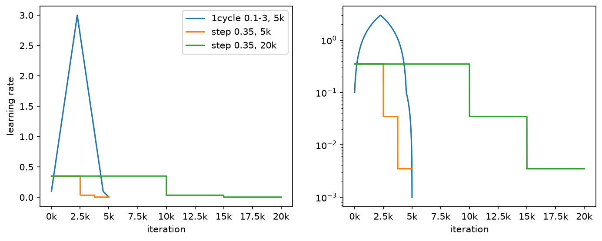
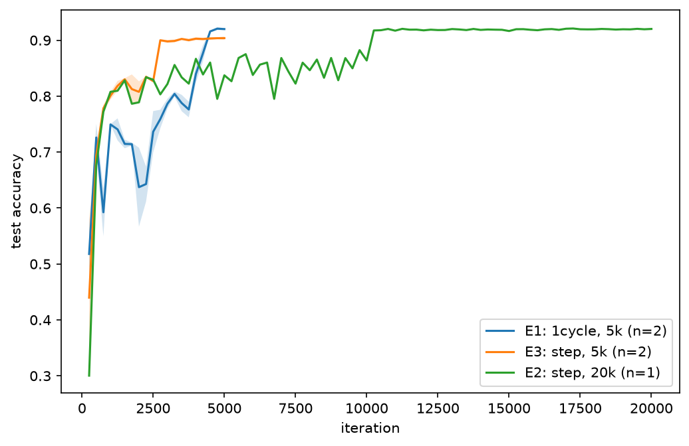
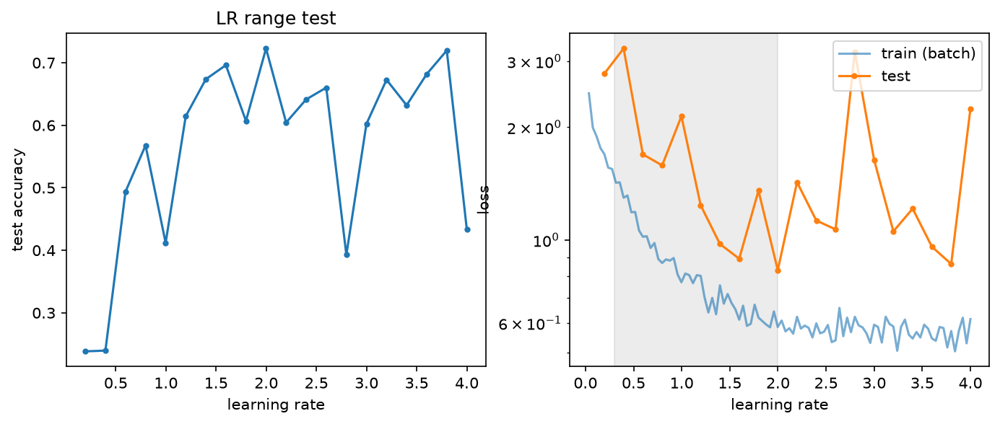
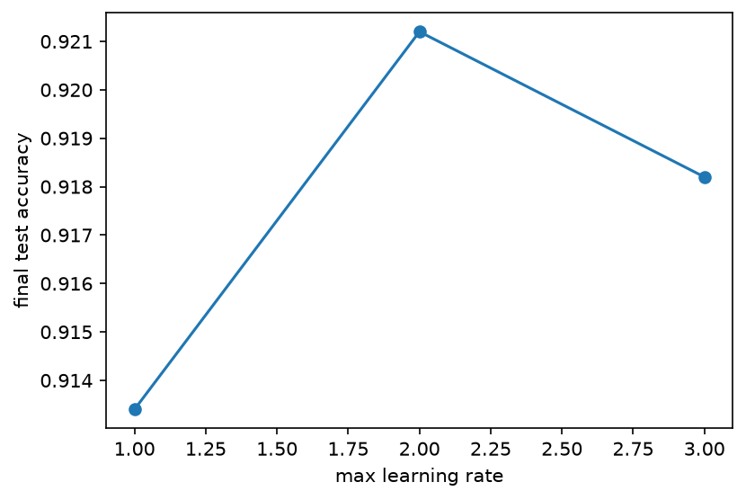
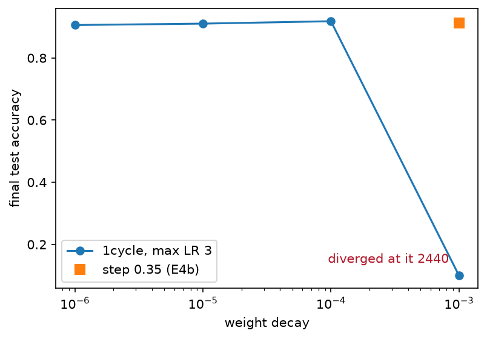
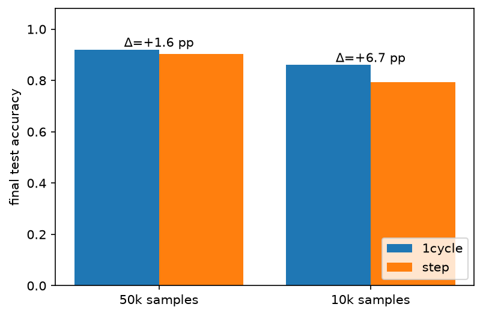

# Отчёт: воспроизведение Super-Convergence на T4

Статья: L. N. Smith, N. Topin. *Super-Convergence: Very Fast Training of Neural Networks Using Large Learning Rates*. arXiv:1708.07120v3.

## Что делали

Проверяли пять утверждений статьи на ResNet-20 и CIFAR-10. Всё обучение шло в Google Colab на одной Tesla T4. Протокол во всех экспериментах один:

- SGD с momentum 0.9;
- батч 1000;
- weight decay 1e-4, если не сказано иное;
- BatchNorm momentum 0.05;
- fp16.

Бюджет задавался в итерациях. Одна итерация занимала 0.083 с, вся очередь из 14 прогонов — около 1 ч 50 мин.

Сравнивали два расписания learning rate:

- **1cycle** — LR линейно растёт с 0.1 до 3 за 45% итераций, так же линейно падает обратно до 0.1 и в последние 10% опускается до 0.001;
- **step** — привычное ступенчатое расписание: старт с 0.35, деление на 10 на половине и на трёх четвертях бюджета.

Главное отличие от статьи — бюджет. Там 1cycle на 10 тыс. итераций сравнивали со step на 80 тыс., у нас 5 тыс. против 20 тыс. (1:4 вместо 1:8). Остальные отличия перечислены в конце.

---

## H1. 1cycle с большим LR достигает точности step в разы быстрее

**Что утверждает статья.** На ResNet-56 1cycle за 10 тыс. итераций даёт 92.4%, а step за 80 тыс. — 91.2% (Fig. 1a). Для ResNet-20 приводятся 90.4% против 88.6% (Fig. 4b).

**Что сделали.** Три эксперимента:

- E1 — 1cycle, 5 тыс. итераций, два сида;
- E3 — step с тем же бюджетом, два сида;
- E2 — step с бюджетом в четыре раза больше, 20 тыс. итераций.

| Эксперимент | Расписание | Итерации | Точность на test |
|---|---|---|---|
| E1 | 1cycle | 5 000 | 92.00 ± 0.25% |
| E3 | step | 5 000 | 90.38 ± 0.42% |
| E2 | step | 20 000 | 92.02% |

**Вывод: подтверждается.** 1cycle за 5 тыс. итераций дошёл до той же точности, что step за 20 тыс. — в четыре раза быстрее. При равном бюджете 1cycle выигрывает 1.6 п.п.

Кривая 1cycle ведёт себя необычно. Пока LR растёт к 3, точность скачет и даже проседает до 64%. Сеть в этот момент не «учится» в привычном смысле, а быстро проходит пространство весов. Почти весь прирост приходится на последние полторы тысячи итераций, когда LR падает. Step-расписание выглядит иначе: плато, скачок после каждого снижения LR, снова плато.

---

## H2. Сеть выдерживает LR на порядок больше обычного

**Что утверждает статья.** В LR range test точность обычно растёт, достигает пика и падает, когда LR становится слишком большим. Для ResNet точность остаётся высокой вплоть до LR = 3, хотя обычно используют около 0.1–0.35 (§3, Fig. 2b). Авторы считают это признаком того, что super-convergence возможна.

**Что сделали.**

- **E0, LR range test:** LR линейно растёт от 0 до 4 за 1000 итераций, точность меряется каждые 50 итераций.
- **E6:** 1cycle с пиком 1 и 2, чтобы сравнить с пиком 3 из E1.

| Пиковый LR в 1cycle | 1 | 2 | 3 |
|---|---|---|---|
| Точность на test | 91.34% | 92.12% | 92.00% |

**Вывод: в целом подтверждается.** На левом графике range test нет пика с последующим обвалом. Начиная с LR около 1.2, точность держится на уровне 60–72% до самого конца, до LR = 4. Сеть действительно не «ломается» при LR в десятки раз больше обычного.

Точки на графике сильно скачут. Предполагаем, что дело в статистиках BatchNorm: они не успевают за весами, которые быстро меняются при большом LR. Поэтому смотреть стоит на общий уровень, а не на отдельные точки.

Пиковый LR важен, но до определённой границы. При LR = 1 точность на 0.7 п.п. ниже, а 2 и 3 дают одно и то же. В статье похожая картина (Table 6): значения от 2.5 до 3.5 почти не отличаются.

---

## H3a. Большой LR работает как регуляризатор

**Что утверждает статья.** На участке LR примерно от 0.3 до 2 в range test loss на train растёт, а loss на test падает (§A.2, Fig. 8). То есть с ростом LR сеть хуже подгоняется под обучающую выборку, но лучше обобщает — это и есть регуляризация.

**Что сделали.** Тот же E0, правый график: loss на train и на test в зависимости от LR. Серым выделен участок 0.3–2.

**Вывод: не наблюдается.** Loss на train падает на всём диапазоне LR, никакого роста нет. Loss на test шумный, уверенной тенденции у него нет.

Причина, по всей видимости, в длине теста. Наш range test длится 1000 итераций — это около 20 эпох. За это время сеть ещё учится, и loss падает просто потому, что обучение продолжается, независимо от LR. В статье range test шёл от 5 до 100 тыс. итераций. Там сеть успевала выйти на плато, и эффект LR был виден отдельно от общего обучения.

Это не опровергает гипотезу. Это значит, что наш эксперимент слишком короткий, чтобы её проверить. Косвенно H3a поддерживает следующий раздел: большой LR и большой weight decay вместе дают перебор регуляризации.

---

## H3b. Регуляризацию нужно балансировать: при большом weight decay эффект пропадает

**Что утверждает статья.** Большой LR сам по себе регуляризует, поэтому остальную регуляризацию нужно ослабить. С weight decay 1e-3 super-convergence не наступает, с 1e-4 и меньше — наступает (§A.6, Fig. 12b).

**Что сделали.**

- **E4:** 1cycle с weight decay 1e-3, 1e-5 и 1e-6; точку 1e-4 берём из E1.
- **E4b**, контроль, которого нет в статье: step с weight decay 1e-3. Он нужен, чтобы отличить «1e-3 вредит всегда» от «1e-3 вредит именно вместе с большим LR».

| Weight decay | 1cycle | step |
|---|---|---|
| 1e-6 | 90.59% | — |
| 1e-5 | 91.05% | — |
| 1e-4 | 91.82% (E1, сид 0) | — |
| 1e-3 | разошлось на итерации 2440 | 91.24% |

**Вывод: подтверждается, и нагляднее, чем в статье.** С weight decay 1e-3 обучение по 1cycle не просто ухудшилось, а разошлось. Случилось это на итерации 2440, почти точно в момент, когда LR достиг пика (итерация 2250).

Step-расписание с тем же weight decay 1e-3 спокойно обучилось до 91.2%. Значит, сам по себе 1e-3 не плох — плохо его сочетание с большим LR. Два источника регуляризации вместе оказались чрезмерными, ровно как говорит статья.

При weight decay 1e-4 и ниже результат почти не меняется: 90.6–91.8%. Небольшое снижение на 1e-6 похоже на признак недостатка регуляризации, но с одним сидом утверждать этого нельзя.

---

## H4. Чем меньше данных, тем сильнее выигрыш

**Что утверждает статья.** На ResNet-56 разрыв между 1cycle и step растёт по мере сокращения обучающей выборки: +2.0 п.п. на 40 тыс. примеров и +9.2 п.п. на 10 тыс. (Table 1).

**Что сделали.** E5: оба расписания на фиксированной случайной подвыборке из 10 тыс. обучающих примеров, 5 тыс. итераций. Сравниваем с E1 и E3 на полных 50 тыс.

| Обучающих примеров | 1cycle | step | Разница |
|---|---|---|---|
| 50 000 | 92.00% | 90.38% | +1.6 п.п. |
| 10 000 | 86.03% | 79.35% | +6.7 п.п. |

**Вывод: подтверждается.** На полных данных 1cycle выигрывает 1.6 п.п., на пятой части данных — 6.7 п.п., то есть разрыв вырос в четыре раза. Масштаб близок к статье (+9.2 п.п. на 10 тыс., но у них ResNet-56 и другой бюджет).

Разумное объяснение: когда данных мало, сеть легче переобучается, и дополнительная регуляризация от большого LR становится ценнее.

---

## Итог

| Гипотеза | Вердикт |
|---|---|
| H1. 1cycle быстрее step | Подтверждена: та же точность за вчетверо меньше итераций |
| H2. Сеть держит LR до ~3 | В целом подтверждена: в range test нет обвала, пик LR 2–3 оптимален |
| H3a. Большой LR регуляризует | Не наблюдается: range test слишком короткий |
| H3b. Регуляризацию нужно балансировать | Подтверждена: при weight decay 1e-3 обучение по 1cycle разошлось, а step нет |
| H4. Выигрыш растёт при малых данных | Подтверждена: +1.6 п.п. на 50 тыс., +6.7 п.п. на 10 тыс. |

Главный результат статьи воспроизводится на одной T4 за пару часов. Один цикл с большим LR даёт ту же точность, что длинное ступенчатое расписание, за четверть итераций. При этом он требует ослабить остальную регуляризацию.

## Ограничения

- **Протокол отличается от статьи:** PyTorch вместо Caffe, одна T4 вместо 8 GPU, fp16, BatchNorm momentum 0.05 для обоих расписаний (в статье для step — 0.999), бюджет 1:4 вместо 1:8. Поэтому наши абсолютные цифры выше статейных (92.0% против 90.4% для 1cycle на ResNet-20), и сравнивать имеет смысл соотношения, а не сами проценты.
- **Мало сидов.** Два сида только у E1 и E3, у остальных по одному. Разницы меньше полупроцента между одиночными прогонами — в пределах шума.
- **Range test короткий** (1000 итераций), из-за этого H3a проверить не удалось.
- **Длину хвоста 1cycle (10% итераций) мы выбрали сами,** в статье она не задана.

Полная таблица всех прогонов — в разделе Results файла [README.md](README.md). Код, конфиги и инструкции по запуску — там же.
